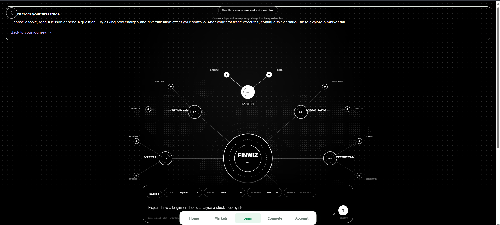
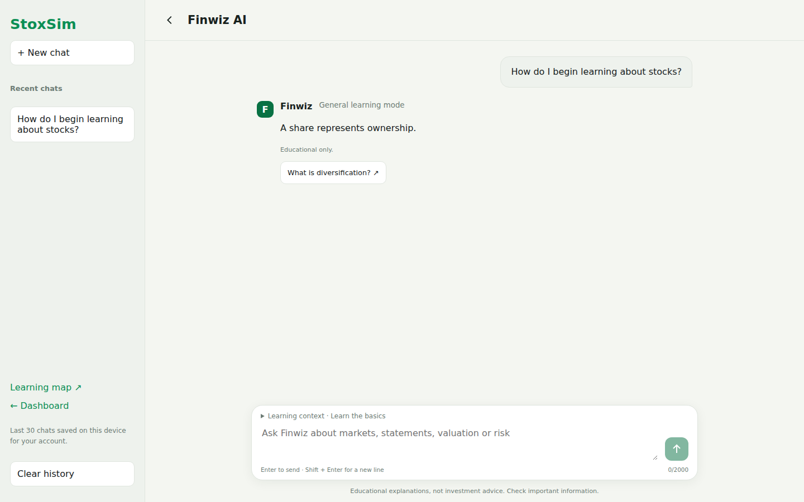
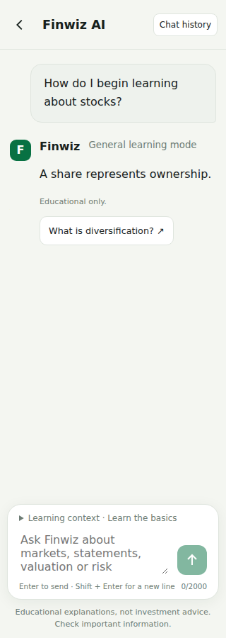
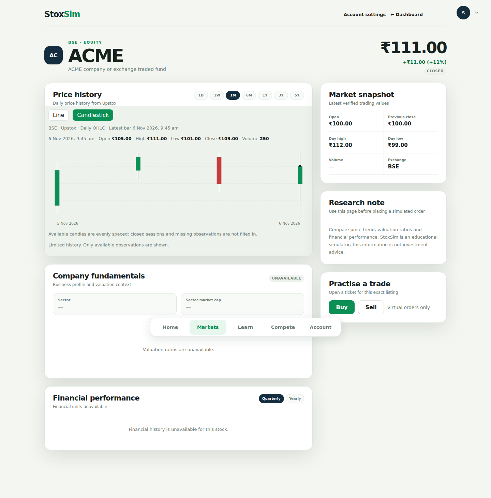
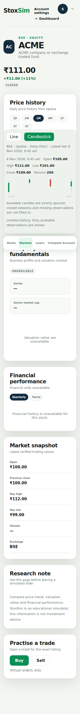

# Finwiz and Markets UI review

The **before** image is the owner's supplied defect reference. The **after** images were captured from the implemented production web build using Playwright fixture accounts, quotes and AI answers; they do not demonstrate live provider acceptance.

## Finwiz before

## Finwiz after — desktop and narrow mobile

## Stock research after

The fixture intentionally includes sparse history and unavailable fundamentals to exercise honest empty states. Real quotes are not substituted. Buy/Sell retain the BSE listing and appear below Research note.

## F&O discovery

Validation covers 320, 768 and 1440 pixels, 200% text, reduced viewport height, keyboard focus, empty/error states, history persistence/clearing, BSE dual listings, chart intervals and new-tab authentication. Reduced viewport checks approximate keyboard space; they are not a physical-device keyboard certification.
